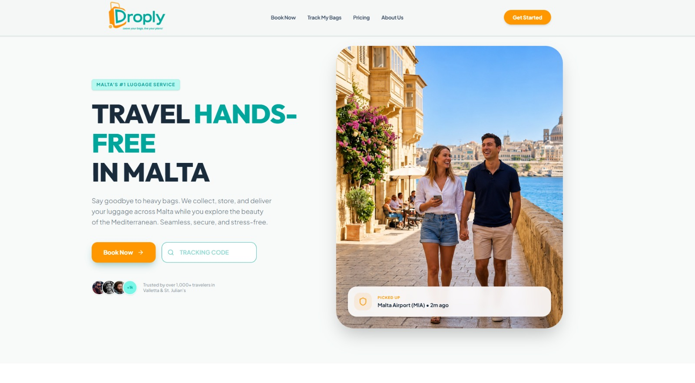
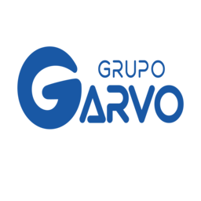

  

  <strong>Desarrollador de software</strong> 
  Web · Móvil · Sistemas de gestión · Integraciones

  
  

## Perfil

<table align="center">
  <tr>
    <td align="center">
      
<strong>Soy desarrollador de software.</strong> Construyo productos web y móviles, además de los sistemas que los sostienen: reservas, pagos, lealtad, pedidos, cotizaciones, puntos de venta e inventarios.

      
· &nbsp; · &nbsp; ·

      
Trabajo en toda la cadena del producto: interfaz, lógica, integraciones, pruebas, build firmado y publicación en tienda. He desarrollado para una plataforma de equipaje en Malta, una estación de servicio, una distribuidora farmacéutica veterinaria y un comercio electrónico.

    </td>
  </tr>
</table>

## Stack

El stack cambia según el producto. Estas son las piezas que más he usado para llevar un proyecto de la operación a la tienda.

<strong>OPERACIÓN → INTERFAZ → DATOS → INTEGRACIONES → BUILD → TIENDA</strong>

<table align="center">
  <tr><th align="center">Área</th><th align="center">Tecnologías</th></tr>
  <tr>
    <td align="center"><strong>01 Interfaz</strong></td>
    <td align="center"><code>React</code> <code>TypeScript</code> <code>JavaScript</code> <code>Next.js</code> <code>Tailwind CSS</code> <code>HTML</code> <code>CSS</code></td>
  </tr>
  <tr>
    <td align="center"><strong>02 App móvil y publicación</strong></td>
    <td align="center"><code>React Native</code> <code>Capacitor</code> <code>Android Studio</code> <code>Google Play Console</code></td>
  </tr>
  <tr>
    <td align="center"><strong>03 Datos e integraciones</strong></td>
    <td align="center"><code>Firebase</code> <code>Firestore</code> <code>Stripe</code> <code>Google Maps</code> <code>Mercado Pago</code></td>
  </tr>
  <tr>
    <td align="center"><strong>04 Documentos y comercio</strong></td>
    <td align="center"><code>jsPDF</code> <code>html2canvas</code> <code>WordPress</code> <code>WooCommerce</code></td>
  </tr>
  <tr>
    <td align="center"><strong>05 Entrega</strong></td>
    <td align="center"><code>Git</code> <code>GitHub</code> <code>Vercel</code></td>
  </tr>
</table>

## Trabajo seleccionado

<table align="center">
  <tr>
    <td align="center">
      <h3 align="center">01 · Droply Malta</h3>
      
<strong>PLATAFORMA WEB · RESERVAS · PAGOS</strong>

      

      
<strong>Qué es.</strong> Plataforma para recoger, almacenar y entregar equipaje en Malta, con flujos separados para clientes, operadores y administración.

      <blockquote>
<strong>Mi aportación.</strong> Desarrollé interfaces y funcionalidades para esos tres perfiles. Trabajé en reservas, pagos con Stripe, webhooks y búsqueda de ubicaciones con Google Maps Places y Autocomplete.
</blockquote>
      
<code>React</code> <code>TypeScript</code> <code>Firebase</code> <code>Firestore</code> <code>Stripe</code> <code>Google Maps</code>

    </td>
  </tr>
</table>

· &nbsp; · &nbsp; ·

<table align="center">
  <tr>
    <td align="center">
      <h3 align="center">02 · Club Pilotos Carreto</h3>
      
<strong>APP MÓVIL · LEALTAD · ANDROID</strong>

      

      
<strong>Qué es.</strong> Aplicación móvil de lealtad para clientes de una estación de servicio: XP, niveles, recompensas, promociones y pase digital.

      <blockquote>
<strong>Mi aportación.</strong> Desarrollé las funciones de XP, niveles, recompensas, promociones y el pase con QR. Preparé y firmé el Android App Bundle y gestioné su publicación en Google Play Console.
</blockquote>
      
<code>React</code> <code>Capacitor</code> <code>Firebase</code> <code>Android Studio</code> <code>Google Play Console</code>

    </td>
  </tr>
</table>

· &nbsp; · &nbsp; ·

<table align="center">
  <tr>
    <td align="center">
      <h3 align="center">03 · Cotizador Grupo Garvo</h3>
      
<strong>SISTEMA WEB · PEDIDOS · REPORTES</strong>

      

      
<strong>Qué es.</strong> Sistema web de pedidos y administración para distribución farmacéutica veterinaria. Cubre catálogo, clientes, vendedores y distribuidores.

      <blockquote>
<strong>Mi aportación.</strong> Desarrollé interfaces para pedidos, catálogo, clientes, vendedores y distribuidores. Implementé filtros, reportes, generación de PDF y funciones para compartir por WhatsApp.
</blockquote>
      
<code>React</code> <code>Tailwind CSS</code> <code>jsPDF</code> <code>html2canvas</code>

    </td>
  </tr>
</table>

## Contacto

<table align="center">
  <tr>
    <td align="center">
      <h3 align="center">Conversemos sobre tu próximo proyecto</h3>
      
<strong>Desarrollador de software · Aplicaciones, sistemas e integraciones</strong>

      
He construido reservas con pagos, programas de lealtad con recompensas y pase digital, cotizadores de campo y sistemas de ventas e inventario. Si tu equipo está contratando o necesita construir una de esas piezas, escríbeme por LinkedIn.

      

      
O revisa el código en <a href="https://github.com/Laloaobes?tab=repositories">GitHub</a>.

      

    </td>
  </tr>
</table>
